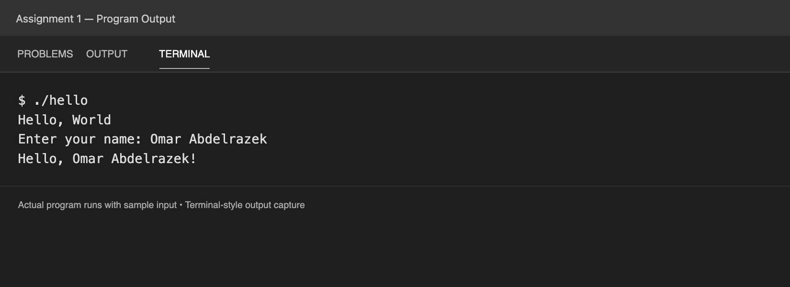

# Assignment 1: Hello World and Name

My program prints “Hello, World,” asks for a name, and prints a greeting. I used a string to store the name, `getline` to read it, and `cout` to display the output.

[View the output as text](output.txt).
