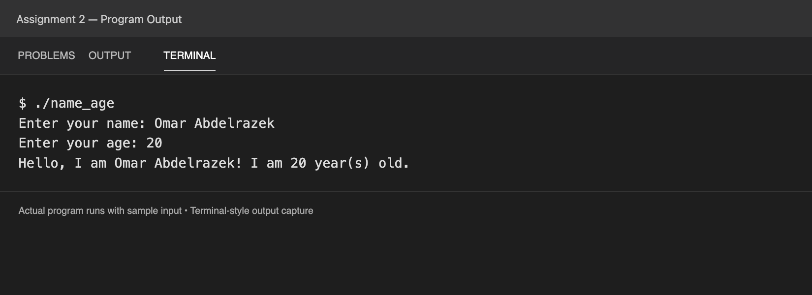

# Assignment 2: Variables, Types, and Input/Output

My program asks for a name and age, then prints a greeting with both values. I stored the name in a string and the age in an integer. I used `getline` to read a full name with spaces, `cin` to read the age, and `cout` to print the greeting.

[View the output as text](output.txt).
