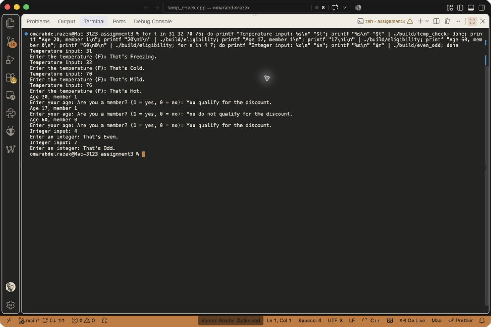

# Assignment 3: Decision Making and Control Flow

I used conditional statements to make decisions in three programs:

- `temp_check.cpp` reads a Fahrenheit temperature and uses `if`, `else if`, and `else` to classify it as freezing, cold, mild, or hot.
- `eligibility.cpp` checks age and membership using logical operators to decide whether someone qualifies for a discount.
- `even_odd.cpp` uses the remainder operator (`%`) to check whether an integer is even or odd.

