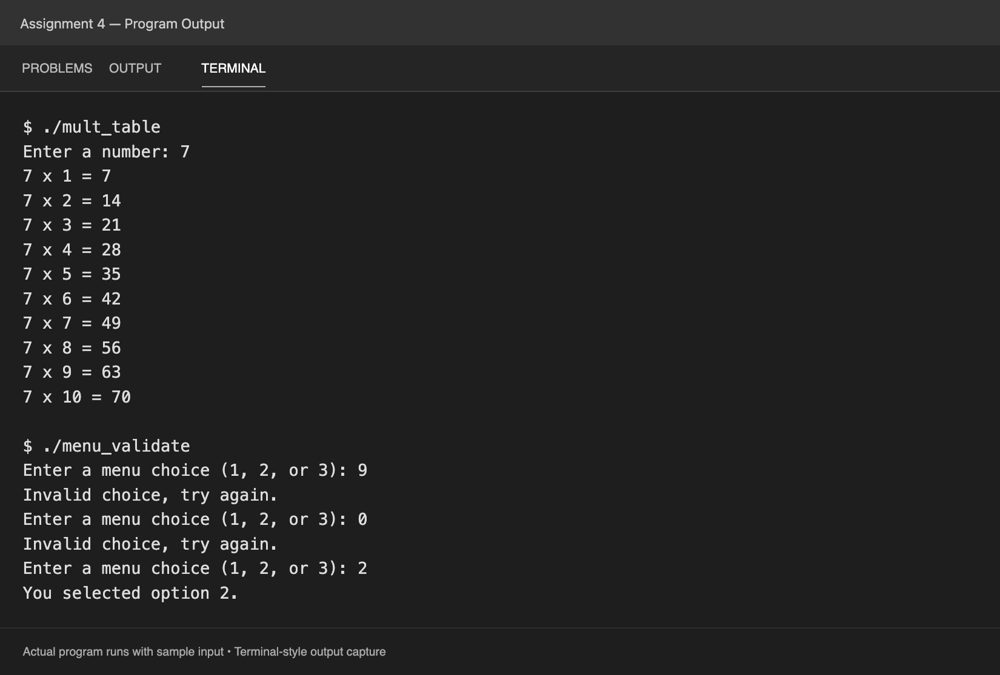

# Assignment 4: Iteration and Loop Patterns

I used loops in two programs:

- `mult_table.cpp` asks for a number and uses a `for` loop to print its multiplication table from 1 through 10.
- `menu_validate.cpp` uses a `do...while` loop to keep asking for a menu choice until the user enters 1, 2, or 3. I added an `if` statement to print an error for invalid choices, then printed the selected option after a valid choice.

[View the output as text](output.txt).
