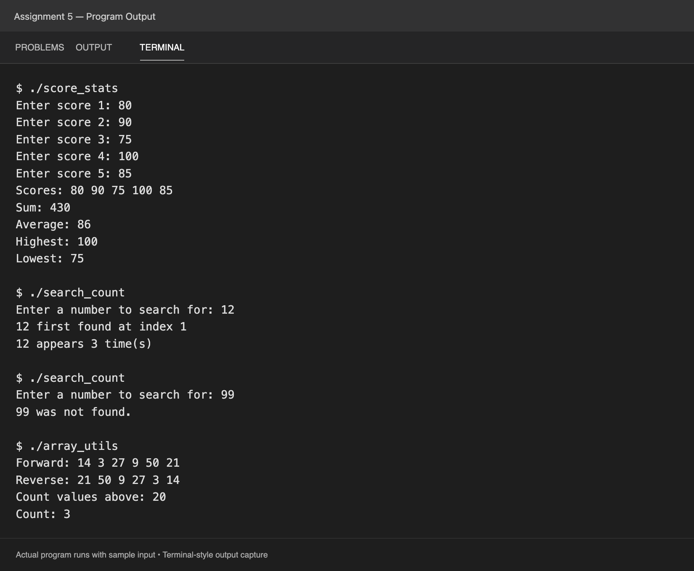

# Assignment 5: One-Dimensional Arrays

I used fixed-size arrays, loops, and functions in three programs:

- `score_stats.cpp` stores five scores in an array and calculates their sum, average, highest score, and lowest score.
- `search_count.cpp` searches an array for a number, records its first index, and counts how many times it appears. It also reports when the number is missing.
- `array_utils.cpp` uses functions to print an array forward and backward and count values greater than a limit entered by the user.

[View the output as text](output.txt).
